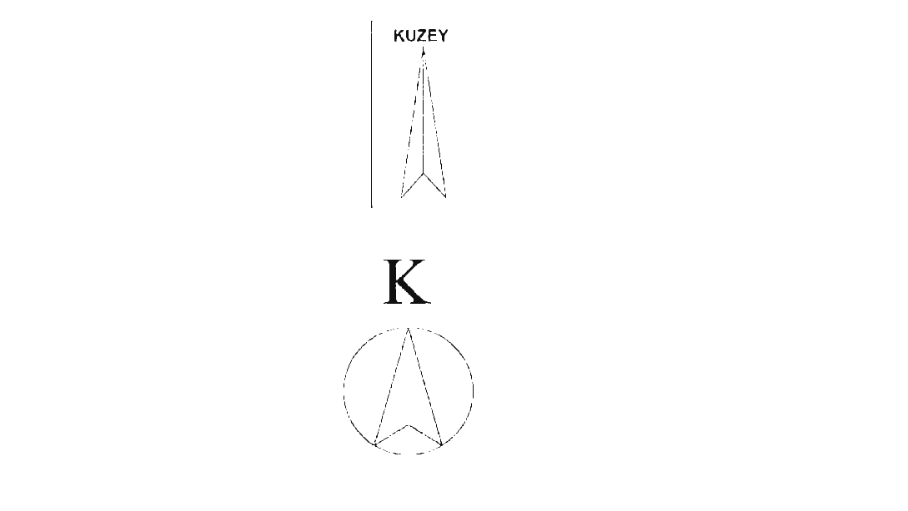
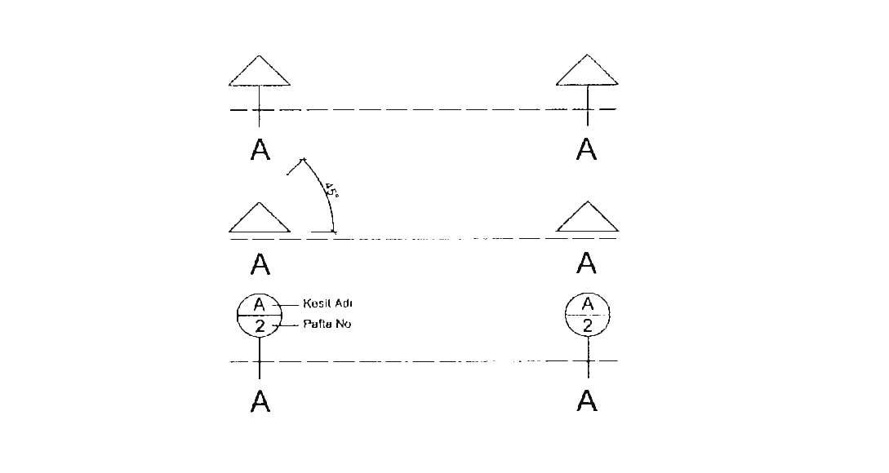
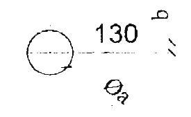
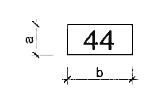
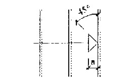
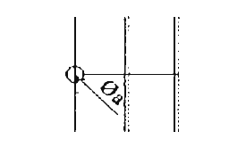
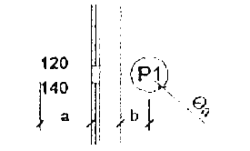

# EK-4 — CAD ortamında çizim hazırlama esasları

> Düzenlenebilir metin ve HTML tablolar. OCR yazımları ile hücre birleştirmeleri otomatik aktarılmıştır; TEYİT BEKLİYOR. Tablolar resim değildir. Grafikler varsa ayrı düzenlenebilir SVG vektörleridir. Bu aktarım hukuki doğrulama veya uygulama kapsamı onayı değildir.

Kaynak: RG 05.08.2026 / 33331.

EK-4 CAD ORTAMINDA ÇİZİM HAZIRLAMA ESASLARI

4.1- Bu ekte, CAD ortamında hazırlanacak çizimlerde proje isimlendirme, dosya isimlendirme, mahal isimlendirme, katman kullanımı ve isimlendirmesi, kullanılacak semboller ve isimlendirmeleri, yazı, ölçü ve çizgi tipleri, taramalar ve yapı aplikasyon projesine ait esaslar verilmiştir.

4.2- Proje isimlendirme esasları EK-I, dosya isimlendirme esasları EK-2, mahal isimlendirme esasları EK-3’te verilmiştir.

4.3- Katman ve sembol isimlendirilmesinde kullanılan isimlendirme şablonları, her disiplin için zorunlu ve isteğe bağlı bilgi alanlarından oluşur. İlgili disiplin için ortak olarak kullanımı zorunlu kılınmış olan bilgi alanları “zorunlu”, kullanımı ihtiyaca göre belirlenecek olan bilgi alanları ise, “isteğe bağlı” olarak ifade edilmiştir.

4.4- Katman ve sembol isimlendirilmesinde kullanılan disiplin kodları EK-2 Madde 2.4’te tanımlanmıştır. Disiplin kodları EK-2 Tablo 2.2'de verilmiştir. İki harfli kısaltma ile temsil edilir.

4.5- Katman ve sembol isimlendirilmesinde kullanılan öge kodları EK-2 Madde 2.5’te tanımlanmıştır. Öge kodları mimari disiplin için EK-2 Tablo 2.3”te, iç mimari disiplini için EK-2

Tablo 2.4”te, harita disiplini için EK-2 Tablo 2.8”te ve zemin disiplini için Tablo 2.11’de verilmiştir. Dört harfli kısaltma ile temsil edilir.

4.6- Peyzaj disiplini için ögeler, katman isimlendirme şablonuna uygun olarak oluşturulur.

4.7- EK-2 Tablo 2.3, Tablo 2.4ve Tablo 2.8’te yer alan öge isimleri ve kısaltmalarının dışında öge isimleri ve kısaltmaları gerekmesi durumunda, öge kısaltmaları katman isimlendirme şablonuna uygun ve ilgili disiplinin tablolarında yer almayan kodlar üretilerek oluşturulur.

4.8- Katman ve sembol isimlendirilmesinde kullanılan alt disiplin kodları statik disiplini için EK-2

Tablo 2.5’ten, mekanik disiplini için EK-2 Tablo 2.6'dan, elektrik disiplini için EK-2 Tablo 2.7’den, altyapı disiplini için EK-2 Tablo 2.9’dan ve peyzaj disiplini için Tablo 2.10’dan alınır. Dört harfli kısaltma ile temsil edilir.

4.9- Alt disiplin için verilen tablolarda yer alanların dışında alt disiplin isimleri ve kısaltmalarının gerekmesi durumunda, katman ve sembol isimlendirme şablonuna uygun ve ilgili disiplinin tablolarında yer almayan yeni kodlar üretilerek kullanılır.

4.10- Katman ve sembol isimlendirilmesinde kullanılan “Malzeme/Malzeme Tipi/Gösterim” bölümünde, CAD çiziminde kullanılan malzeme ya da malzeme tipi veya proje genelinde geçerli gösterim ögelerini içeren bilgi temsil edilir. Malzeme/Malzeme Tipi/Gösterim on beş karakteri geçmeyecek şekilde isimlendirilir. Tarama katmanı da bu alan içinde temsil edilir. 4.11 Katman ve sembol isimlendirmesinde büyük harf kullanılır ve “Ç, G, i, Ö, Ş, Ü” harfleri kullanılmaz. Her yeni bilgi alanı arasında boşluk bırakılmaksızın orta tire işareti “— kullanılır.

4.12- Tüm CAD çizimlerinde farklı çizim elemanlarını gruplamak için katmanlar kullanılır.

4.12.1- CAD çizimlerinde kullanılan yazılımın özelliğine bağlı olarak silinemeyen ve ismi düzenlenemeyen sıfır “0” katmanı gibi katmanlarda çizim yapılmaz.

4.12.2- Mimari proje paftalarında emsal hesabında kullanılmak amacıyla hazırlanmış ayrı katmanlar bulunur. Bu katmanlar, Planlı Alanlar İmar Yönetmeliği ile yapı ruhsatı için başvurulacak idarenin uygulamakta olduğu imar düzenlemelerine göre emsal hesabında kullanılan alanları “emsale dahil alanlar”, “emsalden hariç tutulan alanlar” ve “emsale esas alanın %30’ una kadar yapılabilen alanlar” olarak farklı renklerle taranmış ayrı katmanlar olarak göstermek için kullanılır.

4.12.3- Bu katmanlara ait alanları her kat için ayrı ayrı gösteren tablolar hem kat planlarının yanına yerleştirilir hem de ayrı bir tablo olarak idaresine sunulur. Alan verileri için projeye eklenen hesap katmanlarındaki alan çizgileri değiştirildiğinde söz konusu tabloların da güncellenmesi esastır. İlgili

idare, emsal hesabında kullanılacak bu alanları gösteren katmanları, mimari projelerin üzerinde talep edebileceği gibi kat planlarının yanına yerleştirilmiş ayrı plan krokileri üzerinde de talep edebilir.

4.12.4- Diğer disiplinlerden gelen ve altlık olarak kullanılacak çizimler, disiplin bazında blok halinde ve katmanları kilitli olarak kullanılır. Diğer disiplinlerden gelen projeler blok yapılmadan önce gerekli olmayan bilgilerin katmanları kapatılır.

4.13- Tüm CAD çizimlerinde katmanlar proje disiplinine uygun şekilde isimlendirilir.

4.13.1- Disiplinden bağımsız olarak proje genelinde geçerli olan çizim elemanlarının gösterilmesi durumunda ilgili katmanda “Genel” kısaltması yerine “GENİ.” alt disiplin kısaltması kullanılır. 4.14, Mimarlık, iç mimarlık, harita ve zemin disiplinleri için uygulanacak katman isimlendirme şablonu Tablo 4. |*de verilmiştir.

4.14.1- Katman isimleri oluşturulurken zorunlu olan disiplin ve öge bilgi alanlarının yanı sıra gereken durumlarda zorunluluğa bağlı olarak “Malzeme/Tip” alanı gerekli açıklamaları içerecek şekilde eklenir.

4.14.2- Emsal hesabında kullanılacak katmanlar EK-2 Tablo 2.3’te yer alan EMSL öge kısaltması kullanarak hazırlanır. Emsal ile ilgili katman isimlerinin temsili için Malzeme/Tip alanında yalnızca emsale dair kısaltmalar kullanılır. Bu kısaltmalar, emsale dahil alanların temsil edildiği katmanların isimlendirmesi için “DAHIL”, emsal dışı alanların temsil edildiği katmanların isimlendirmesi için “HARIC” ve ilgili idarenin özel imar düzenlemelerine bağlı olarak, emsale esas alanın artış yapılabilen alanlarının temsil edildiği katmanların isimlendirmesi için “DIGER” kullanılır.

4.14.3- Plan ve kesit çizimlerinde, kesit ve görünüşe giren yerlerde, katman listesinde ismi verilen malzemeyi ifade eden katman isimleri kullanılır. Aynı malzeme için görünüşe giren ögenin uzaklığına bağlı olarak, malzeme tanımlı katman isminin sonuna orta tire işareti “-" ile birlikte farklı derinlikte konumlanmayı ifade eden sıra numarası eklenebilir. 1-4 arası yakınlık ölçeğiyle, en yakındaki görünüşe giren öge, malzeme isminin sonuna "1", en uzaktakinin sonuna ise "4" rakamı konularak ifade edilir.

4.14.4- Cephe çizimlerinde, malzeme tanımını içeren katman isimleri kullanılır. Farklı derinlikte görünüşe giren aynı türden malzemeler için 1-4 arası yakınlık ölçeğiyle, en yakındaki görünüşe giren öge, malzeme isminin sonuna "1", en uzaktakinin sonuna ise "4" rakamı konularak ifade edilir.

4.14.5- Tarama yapılmak istenen öge ilgili katman adının sonuna orta tire işareti "-" ve "T" harfi eklenerek oluşturulan ayrı bir katmanda taranır.

4.15- Statik, mekanik, elektrik ve altyapı projeleri için uygulanacak katman isimlendirme şablonu

Tablo 4.2'de verilmiştir.

4.15.1- Katman isimleri oluşturulurken zorunlu olan disiplin ve alt disiplin bilgi alanlarının yanı sıra zorunlu olarak “Malzeme/Tip/Gösterim” bilgi alanı eklenir,

4.16- Peyzaj disiplini için uygulanacak “Peyzaj Katman İsimlendirme Şablonu” Tablo 4.3’te verilmiştir.

4.16.1- Katman isimleri oluşturulurken zorunlu olan disiplin, alt disiplin ve öge bilgi alanlarının yanı sıra isteğe bağlı olarak “Malzeme/Tip/Gösterim” bilgi alanı eklenir.

4.17- Semboller çizilirken katman isimleri aynı kalmak koşulu ile farklı çizgi rengi kullanılabilir. Sembol rengi katman renginden farklı olabilir, katman renginde yapılacak değişikliklerin sembolleri etkilememesi için semboller çizilirken çizgi rengini katman adına bağlayan komutlar kullanılmaz.

4.17.1- Proje genelinde kullanılabilecek başlıca semboller (bilgi için) açıklamaları ile Şekil 4.1, Şekil 4.2, Şekil 4.3, Şekil 4.4, Şekil 4.5 ve Şekil 4.6'da verilmiştir. Bu bölümde gösterilen kuzey oku, kot işaretleri, kesit hattı ve aks gösterimleri proje disiplinlerinden bağımsız olarak tüm disiplinlerin ilgili paftalarında kullanılır.

4,17,2- Elektrik projesi sistem kolon şeması çizimlerinde ana besleme hatları, şebeke kolon hatları, UPS kolon hatları ve benzeri sistem farklılıklarında renk ayrımı yapılır. Paftalarda sembol lejantı bulunur ve blok isimleri ile açıklamaları burada belirtilir.

4.17.3- Farklı disiplinlere ait projelerde ihtiyaç duyulan diğer semboller lejantta gösterilir. Tefriş amaçlı sembol kullanımları lejantta yer almaz.

4.17.4- Sayılabilir ögeler blok olarak oluşturulur. Blok isimleri blokun içeriğine ait temel özelliklerini ifade eder.

4.17.5- Semboller çizilirken blok içindeki çizgiler ve sembolün kendisi aynı katmanda çizilir.

4.17.6- Projelerde kullanılan sembollere ilişkin açıklamalar paftada yer alan lejantta verilir.

4.18- Mimarlık, iç mimarlık, harita ve zemin projelerinde blok, obje, sembol isimleri için kullanılacak şablon Tablo 4.4”te verilmiştir.

4.18.1- Zorunlu olan “Disiplin” ve “Öge” tanımlarına ek olarak, isteğe bağlı “Malzeme/ Tip/Gösterim” tanımlaması ve isteğe bağlı “Ebat/Adet/Ozellik” tanımlaması da yapılır ve kullanılan semboller İejantta gösterilerek açıklanır.

4.18.2- Mimari projelerde pencere, kapı, tefriş elemanları gibi ögeler blok olarak gösterilir.

4.18.3- Peyzaj projesinde kullanılacak sembol, obje ve blok isimlendirmesi Tablo 4.4’te verilen isimlendirme şablonuna göre genişletilir. Mimari sembol listesindeki kuzey yönü, kot gösterimleri, kesit hattı gibi teknik resim ifadeleri peyzaj projelerinde de belirtilen şekilde kullanılır. Verilen modele göre “Malzeme/ Tip” bölümünde bitkilerin isimleri detaylandırılabilir.

4.18.4- Peyzaj projesinde her sembol, projede tek bir bitki türü için kullanılır. Kullanılan bitki sembolü gibi, bitki bilgisi de adet ve isim bilgisini içerecek şekilde açıkça ifade edilir. Aynı bitki sembolleri, merkezlerinden geçirilen çizgi ile işaretlenerek, bitkinin dışında uygun bir boşluğa adet ve isim bilgisi girilir.

4.18.5- Peyzaj projesinde bitki ismi yazılırken, bilimsel ismi tam olarak yazılır veya uluslararası kısaltma terminolojisine uygun şekilde kısaltma yapılarak kullanılır. Ağaç ve ağaççıklar için büyük harflerle Latince cins ve tür isminin ilk üç harfi, çalılarda baş harfi büyük olacak şekilde cins isminin ilk üç harfi, tür isminin ilk iki harfi yazılır. Sarılıcı, yer örtücü, çiçek gibi diğer bitki türlerinin kisaltmasi da galilarda olduğu gibi yazılır.

4.19- Statik, mekanik ve elektrik projeleri blok, obje ve sembol isimleri için kullanılacak şablon

Tablo 4.5’te verilmiştir.

4.19.1- Zorunlu olan “Disiplin” ve “Alt Disiplin” in yanı sıra, isteğe bağlı “Tip/Malzeme/Gösterim” tanımlaması ve isteğe bağlı “Ebat/Adet/Ozellik” tanımlaması da yapılır ve kullanılan semboller lejantta gösterilerek açıklanır.

4.19.2- Statik projelerde grafik sembol kullanımı yerine markalama yapılır.

4.20- Altyapı projesi blok, obje ve sembol isimleri için kullanılacak şablon Tablo 4.6'da verilmiştir.

4.20.1- Sembol isimleri, zorunlu olan “Disiplin” in yanı sıra isteğe bağlı olarak kullanılan “Tip/Malzeme/Gösterim” ve “Ebat” alanları kullanılarak üretilir ve kullanılan semboller lejantta gösterilerek açıklanır.

4.21- 1/5 ile 1/5000 arası ölçeklerde uygulanacak yazı tipleri ve punto büyüklükleri bilgi için Tablo 4.7'de verilmiştir.

4.21.1- Projelerde kullanılacak yazı tipleri için “TS EN TSO 3098-1 Teknik mamül dokümantasyonu- Yazılar-Bölüm 1: Genel kurallar” ve “TS EN ISO 128-2 Teknik ürün belgeleri (TPD) - Genel gösterim ilkeleri - Bölüm 2: Çizgiler için temel kurallar” standartları esas alınır.

4.21.2- Ölçülendirmede yazı karakterleri olarak “Times New Roman”, “Arial”, “Calibri”, “Romans” ve “Tahoma” fontları kullanılabilir.

4.22- Çizgi tiplerinin kullanımında “TS EN ISO 128-2 Teknik ürün belgeleri (TPD) - Genel gösterim ilkeleri - Bölüm 2: Çizgiler için temel kurallar” standardı esas alınır.

4.22.1- Farklı disiplinlere ait projelerden getirilen çizimlere ait çizgi renkleri kalman ismi değiştirilmeden katmana bağlı renk seçimi ayarı yapılarak kullanılır.

4.23- Tarama tiplerinin kullanımında “TS EN ISO 128-3 Teknik ürün dokümantasyonu (TPD)- Genel sunum ilkeleri- Bölüm 3: Görünümler, enkesitleri ve kesimler” standartları esas alınır.

4.23.1- Tüm farklı malzemeler farklı tarama tipi ile ifade edilir. Aynı tarama türü, farklı ölçeklerde kullanılmaz. Proje setlerinde kullanılan tarama türleri lejant olarak projede verilir.

4.24- Planlarda kullanılabilecek kot, mekan kod numarası etiketi, merdiven çıkış çizgisi ve kapı pencere pozlarına ait işaretlerin gösterim biçimleri bilgi için Şekil 4.7’de verilmiştir.

4.25- Planlarda Kuzey Oku İşareti gösterimi bilgi için Şekil 4.1*de verilmiştir. Planlarda kuzey oku işareti gösterimleri tüm disiplinlerin ilgili paftalarında kullanılacaktır. Harita ölçümlerinden belirlenen hedef harita koordinat referans sisteminin doğu ekseniyle, yerel X ekseninin Kuzey ve Doğu bileşeniyle uyumlu bir şekilde tanımlanır.

4.26- Planlarda Kot İşareti gösterimi bilgi için Şekil 4.2'de verilmiştir. Planlarda kot işareti gösterimi tüm disiplinlerin ilgili paftalarında kullanılacaktır.

4.27- Kesit ve Görünüşlerde Kullanılan Kot İşareti Gösterimi bilgi için Şekil 4.3’te verilmiştir. Planlarda kot işareti gösterimi tüm disiplinlerin ilgili paftalarında kullanılacaktır.

4.28- Kesit Hattı Yerinin Gösterim Çizgisi çeşitleri bilgi için Şekil 4.4’te verilmiştir. Kesit hattını gösteren çizgi, noktalı kesikli çizgi ile çizilir. Bakış yönünü gösteren okun ucu bakış tarafına bakar. Kesit hattı gösteriminde bakış yönü belirtilir. Kesit hattı gösterimi tüm disiplinlerin ilgili paftalarında kullanılır.

4.29- Aks çizgilerinin gösterimi (bilgi için) Şekil 4.5'te verilmiştir. Aks çizgileri noktalı kesikli çizgi ile çizilir, Aks numarasını çevreleyen yuvarlaklar sürekli çizgi ile çizilir. Aks çizgilerinin gösterimi tüm disiplinlerin ilgili paftalarında kullanılır.

4.30- Tabii Zemin Kotu ve Tesviye Kotu Gösterimi bilgi için Şekil 4.6'da verilmiştir ve gösterimi tüm disiplinlerin ilgili paftalarında kullanılır.

4.31- Yapı aplikasyon projesi bu ekte verilen teknik esaslara uygun olarak hazırlanır:

4.31.1- Yapı aplikasyon projesinde tüm ölçü, nokta ve koordinatlar TUREF (Türkiye Ulusal Temel GPS Ağı - ITRF96) 3° koordinat sisteminde hazırlanır. Modelin bulunduğu 39 dilime karşılık gelen EPSG kodu (EPSG: 5253-5259 arası) açıkça belirtilir ve sayısal model içerisinde tanımlanır. İdareler tarafından başka bir koordinat sistemine dönüşüm istenmesi halinde dönüşüm parametreleri ayrıca belirtilir.

4.31.2- Parsel üzerinde birden çok yapı bulunması halinde, her yapı bloku için ayrı bir aplikasyon projesi düzenlenir. Blokların birbirleriyle mesafe, çekme mesafesi, kot farkı gibi konumsal ilişkisi “Genel Vaziyet Aplikasyon Planı” başlığıyla ayrıca gösterilir.

4.31,3- Parsel köşe noktalarının numaralandırılması parselin, LİHKAB'tan alınan aplikasyon krokisine uygun olarak yapılır. Yapıya ait aplikasyon noktaları için YI, Y2, Y3, ... formatında standardize edilmiş kodlama kullanılır. Aynı parselde birden fazla yapı bulunması halinde her yapı için A-YI, A-Y2; B-Y1, B-Y2 şeklinde blok kodu ön eki kullanılması zorunludur.

4.31.4-Yapı ve parsele ilişkin tüm kotlar, Türkiye Jeoit Modeli’ne dayalı Helmert Ortometrik Yükseklik Sisteminde gösterilir. Yapı köşe noktalarının Z (yükseklik) değerleri, giriş kotu, temel kotu, £0.00 kotu ve gabari kotları zorunlu olarak belirtilir.

4.31.5- Yapı ile ilişkili tüm kotlar, parselin resmi referans yüksekliği sistemine göre gösterilir. Yapı köşe noktalarının Z (yükseklik) değerleri, giriş kotu, temel kotu, +0.00 kotunun hangi referansa göre tanımlandığı ve gabari kotları zorunlu olarak belirtilir.

4.31.6- Koordinat sistemi, referans yüksekliği, numaralandırma esasları, ölçek, kullanılan semboller ve açıklamalar yapı aplikasyon projesi üzerinde yer alan lejant kısmında belirtilir.

4.31.7- Yapı aplikasyon projesinin boyutu, dosya isimlendirme ve dijital dosya tesliminde diğer projeler için geçerli esaslar dikkate alınır.

## Tablo 4.1 Mimarlık, İç Mimarlık, Harita ve Zemin Projeleri Katman İsimlendirme Şablonu

<table>
<tbody>
<tr>
<td>Bilgi Alanı</td>
<td>Disiplin (Zorunlu)</td>
<td>Öge (Zorunlu)</td>
<td>Malzeme / Tip / Gösterim (Zorunlu)</td>
</tr>
<tr>
<td>Karakter Sayısı</td>
<td>2</td>
<td>4</td>
<td>En fazla 15 karakter</td>
</tr>
<tr>
<td>Veri Türü</td>
<td colspan="2">Alfabetik</td>
<td>Alfanümerik</td>
</tr>
</tbody>
</table>

## Tablo 4.2 Statik, Mekanik, Elektrik ve Altyapı Projeleri Katman İsimlendirme Şablonu

<table>
<tbody>
<tr>
<td>Bilgi Alanı</td>
<td>Disiplin (Zorunlu)</td>
<td>Alt Disiplin (Zorunlu)</td>
<td>Malzeme / Tip / Gösterim (Zorunlu)</td>
</tr>
<tr>
<td>Karakter Sayısı</td>
<td>2</td>
<td>4</td>
<td>En fazla 15 karakter</td>
</tr>
<tr>
<td>Veri Türü</td>
<td colspan="2">Alfabetik</td>
<td>Alfanümerik</td>
</tr>
</tbody>
</table>

## Tablo 4.3 Peyzaj Projesi Katman İsimlendirme Şablonu

<table>
<tbody>
<tr>
<td>Bilgi Alanı</td>
<td>Disiplin (Zorunlu)</td>
<td>Alt Disiplin (Zorunlu)</td>
<td>Öge (Zorunlu)</td>
<td>Malzeme / Tip / Gösterim (İsteğe Bağlı)</td>
</tr>
<tr>
<td>Karakter Sayısı</td>
<td>2</td>
<td>4</td>
<td>4</td>
<td>En fazla 15 karakter</td>
</tr>
<tr>
<td>Veri Türü</td>
<td colspan="3">Alfabetik</td>
<td>Alfanümerik</td>
</tr>
</tbody>
</table>

| | Şablonu

## Tablo 4.4 Mimarlık, İç Mimarlık, Harita ve Zemin Projeleri Blok, Obje ve Sembol İsimlendirme

<table>
<tbody>
<tr>
<td>Bilgi Alanı</td>
<td>Disiplin (Zorunlu)</td>
<td>Öge (Zorunlu)</td>
<td>Malzeme / Tip / Gösterim (İsteğe Bağlı)</td>
<td>Ebat / Adet / Özellik (İsteğe Bağlı)</td>
</tr>
<tr>
<td>Karakter Sayısı</td>
<td>2</td>
<td>4</td>
<td>En fazla 15 karakter</td>
<td>En fazla 10 karakter</td>
</tr>
<tr>
<td>Veri Türü</td>
<td colspan="2">Alfabetik</td>
<td colspan="2">Alfanümerik</td>
</tr>
</tbody>
</table>

## Tablo 4.5 Statik, Mekanik ve Elektrik Projeleri Blok, Obje ve Sembol İsimlendirme Şablonu

<table>
<tbody>
<tr>
<td>Bilgi Alanı</td>
<td>Disiplin (Zorunlu)</td>
<td>Alt Disiplin (Zorunlu)</td>
<td>Tip / Malzeme / Gösterim (İsteğe Bağlı)</td>
<td>Ebat / Adet / Özellik (İsteğe Bağlı)</td>
</tr>
<tr>
<td>Karakter Sayısı</td>
<td>2</td>
<td>3</td>
<td>En fazla 15 karakter</td>
<td>En fazla 10 karakter</td>
</tr>
<tr>
<td>Veri Türü</td>
<td colspan="2">Alfabetik</td>
<td colspan="2">Alfanümerik</td>
</tr>
</tbody>
</table>

## Tablo 4.6 Altyapı Projesi Blok, Obje ve Sembol İsimlendirme Modeli

<table>
<tbody>
<tr>
<td>Bilgi Alanı</td>
<td>Disiplin (Zorunlu)</td>
<td>Tip / Malzeme / Gösterim (İsteğe Bağlı)</td>
<td>Ebat (İsteğe Bağlı)</td>
</tr>
<tr>
<td>Karakter Sayısı</td>
<td>2</td>
<td>En fazla 15 karakter</td>
<td>En fazla 10 karakter</td>
</tr>
<tr>
<td>Veri Türü</td>
<td>Alfabetik</td>
<td colspan="2">Alfanümerik</td>
</tr>
</tbody>
</table>

## Tablo 4.7 Yazı Karakteri ve Punto Büyüklükleri Tablosu

<table>
<tbody>
<tr>
<td colspan="2">ÖLÇEKLERE GÖRE KULLANILABİLECEK YAZI KARAKTERLERİ PUNTOLARI TABLOSU (bilgi için)</td>
</tr>
<tr>
<td>YAZI TİPİ</td>
<td>PUNTO</td>
</tr>
<tr>
<td>ARIAL</td>
<td>8-15</td>
</tr>
<tr>
<td>TIMES NEW ROMAN</td>
<td>9-16</td>
</tr>
<tr>
<td>CALIBRI</td>
<td>8-16</td>
</tr>
<tr>
<td>CENTURY</td>
<td>10-15</td>
</tr>
<tr>
<td>ISO SHX</td>
<td>9-16</td>
</tr>
</tbody>
</table>

| ! G

Şekil 4.1 Örnek Kuzey Oku İşareti Gösterim Çeşitleri (bilgi için)

Şekil 4.2 Örnek Kot İşareti Gösterimi (Planlar) (bilgi için)

Şekil 4.3 Kot İşareti Gösterimi (Kesitler ve Görünüşler) (bilgi için)

Şekil 4.4 Kesit Hattı Gösterim Çeşitleri (bilgi için)

Şekil 4.5 Aks Gösterimi (bilgi için)

Şekil 4.6 Tabii Zemin Kotu ve Tesviye Kotu Gösterimi (bilgi için)

## Şekil 4.7 Planda Ölçülendirme ve Kodlama İşaretleri (bilgi için)

<table>
<tbody>
<tr>
<td rowspan="2">İşaretin Adı</td>
<td rowspan="2">İşaret</td>
<td rowspan="2"></td>
<td colspan="4">Çizim Ölçeği</td>
</tr>
<tr>
<td>1/200</td>
<td>1/100</td>
<td>1/50</td>
<td>1/20</td>
</tr>
<tr>
<td rowspan="2">Planda kot</td>
<td rowspan="2"> </td>
<td>Øa</td>
<td>3</td>
<td>3</td>
<td>5</td>
<td>7</td>
</tr>
<tr>
<td>b</td>
<td>1</td>
<td>1</td>
<td>1</td>
<td>1</td>
</tr>
<tr>
<td rowspan="2">Mekânların kod numaraları</td>
<td rowspan="2"> </td>
<td>a</td>
<td>-</td>
<td>5</td>
<td>5</td>
<td>7</td>
</tr>
<tr>
<td>b</td>
<td>-</td>
<td>10</td>
<td>10</td>
<td>14</td>
</tr>
<tr>
<td>Merdiven çıkış çizgisi bitimi</td>
<td> </td>
<td>a</td>
<td>1</td>
<td>1.5</td>
<td>2</td>
<td>4</td>
</tr>
<tr>
<td>Merdiven çıkış çizgisi başlangıcı</td>
<td> </td>
<td>Øa</td>
<td>1</td>
<td>1</td>
<td>2</td>
<td>2.5</td>
</tr>
<tr>
<td rowspan="3">Kapı ve pencere pozu</td>
<td rowspan="3"> </td>
<td>Øa</td>
<td>-</td>
<td>5</td>
<td>5</td>
<td>7</td>
</tr>
<tr>
<td>a</td>
<td>-</td>
<td>7</td>
<td>7</td>
<td>9</td>
</tr>
<tr>
<td>b</td>
<td>-</td>
<td>4</td>
<td>4</td>
<td>5</td>
</tr>
</tbody>
</table>

|
